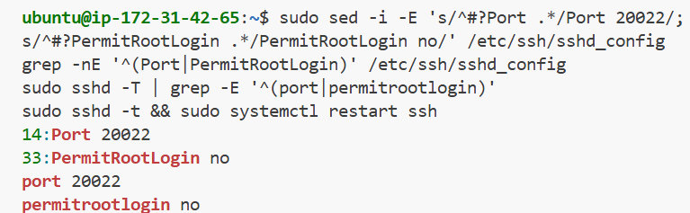
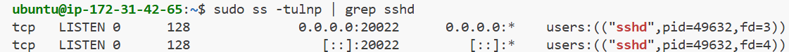
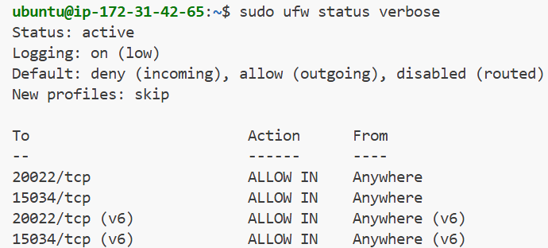
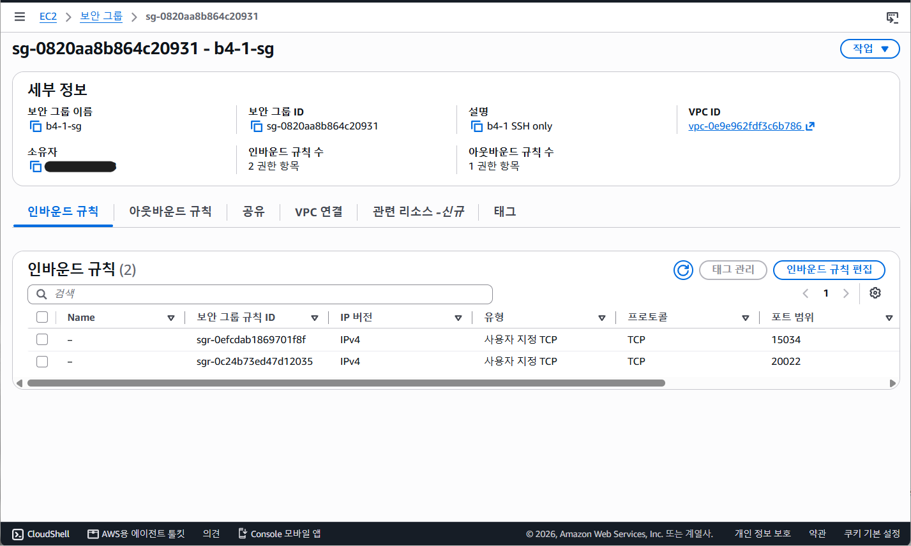

# B4-1 요구사항 수행 내역서

## 1. 문단속 (SSH 포트·Root 차단·방화벽)

### 1-1. SSH 포트 20022 + Root 원격 로그인 차단

`/etc/ssh/sshd_config`의 `Port`와 `PermitRootLogin` 줄을 바꾸고, 문법 검사를 통과한 뒤에만 `ssh` 서비스를 재시작했다.

```bash
sudo sed -i -E 's/^#?Port .*/Port 20022/; s/^#?PermitRootLogin .*/PermitRootLogin no/' /etc/ssh/sshd_config
grep -nE '^(Port|PermitRootLogin)' /etc/ssh/sshd_config
sudo sshd -T | grep -E '^(port|permitrootlogin)'
sudo sshd -t && sudo systemctl restart ssh
```

- 설정 파일: 14행 `Port 20022`, 33행 `PermitRootLogin no`
- 실제 적용값(`sshd -T`): `port 20022`, `permitrootlogin no`



포트 LISTEN 확인(`sudo ss -tulnp | grep sshd`): sshd가 `0.0.0.0:20022`와 `[::]:20022`에서 LISTEN 중이고 22번은 없다.



### 1-2. 방화벽(UFW): 20022/tcp, 15034/tcp만 허용

기본 정책을 "들어오는 연결 전부 거부"로 두고 필요한 두 포트만 열었다. 허용 규칙을 먼저 넣고 `enable`을 나중에 해서, 켜는 순간 접속이 막히지 않게 했다.

```bash
sudo ufw default deny incoming
sudo ufw default allow outgoing
sudo ufw allow 20022/tcp
sudo ufw allow 15034/tcp
sudo ufw enable
sudo ufw status verbose
```

`Status: active`, `Default: deny (incoming)`, 허용 규칙은 `20022/tcp`·`15034/tcp`(IPv4·IPv6 각각)뿐이다.



### 1-3. AWS 보안 그룹(`b4-1-sg`)

UFW는 서버 안쪽 방화벽이고 보안 그룹은 AWS가 서버 앞에 두는 바깥 방화벽이라 둘 다 열어야 접속된다. 인바운드 규칙은 TCP 15034, TCP 20022 두 개만 남겼고 기존 22번 규칙은 삭제했다.



### 1-4. 설계 선택 (왜)

- **새 포트를 먼저 열고 SSH 포트를 바꿈**: 보안 그룹과 UFW에서 20022를 열지 않은 채 sshd만 바꾸면 서버에 다시 들어갈 수 없다. 그래서 허용 → sshd 변경 → 22 삭제 순서로 했다.
- **`sshd -t && restart`**: 설정 문법이 틀린 채 재시작하면 sshd가 못 떠서 접속이 끊긴다. 검사를 통과해야만 재시작되게 묶었다.
- **`sshd -T`로 실제 적용값 확인**: 설정 파일 줄만 보면 `sshd_config.d/`의 다른 파일이 덮어쓴 값을 놓칠 수 있어서, 합쳐진 최종값도 함께 확인했다.
- **UFW 선택**: Ubuntu 기본 도구라 명령이 짧다.
