# B4-1 요구사항 수행 내역서

실습 서버는 AWS EC2(Ubuntu 22.04.5 LTS, `t3.micro`)이고, 아래 절 순서는 작업 순서와 같다. 필수 증거 8개는 이렇게 대응한다.

| # | 필수 증거 | 위치 | 캡처 |
|---|---|---|---|
| 1 | SSH 포트 20022 · Root 원격 접속 차단 | [§1-1](#1-1-ssh-포트-20022--root-원격-로그인-차단) | `step_1_01` `step_1_02` |
| 2 | 방화벽 활성화, 20022·15034/tcp만 허용 | [§1-2](#1-2-방화벽ufw-20022tcp-15034tcp만-허용) · [§1-3](#1-3-aws-보안-그룹b4-1-sg) | `step_1_03` `step_1_04` |
| 3 | 계정·그룹 생성 | [§2-1](#2-1-그룹과-계정) | `step_2_01` |
| 4 | 디렉토리 구조·권한(ACL 포함) | [§2-2](#2-2-디렉토리와-권한) · [§2-3](#2-3-접근-확인) | `step_2_02` `step_2_03` |
| 5 | Boot Sequence 5단계 `[OK]` · `Agent READY` | [§3-3](#3-3-앱-실행-boot-sequence와-포트) | `step_3_02` `step_3_03` |
| 6 | `monitor.sh` 실행 결과(프로세스·포트·리소스·경고) | [§4](#4-monitorsh-점검-스크립트) | `step_4_01` `step_4_02` `step_4_03` |
| 7 | `monitor.log` 누적 기록(최근 라인) | [§5-1](#5-1-monitorlog-누적-기록) · [§6-2](#6-2-자동-실행-확인-1분-후-로그-증가) | `step_5_01` `step_5_02` `step_6_02` |
| 8 | crontab 매분 등록 · 자동 실행(1분 후 로그 증가) | [§6](#6-cron-매분-실행) | `step_6_01` `step_6_02` |

서버 환경은 `lsb_release -a`와 `uname -m`으로 확인했다(Ubuntu 22.04.5 LTS, x86_64).

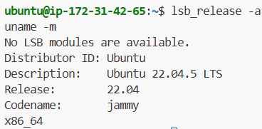

## 1. 문단속 (SSH 포트·Root 차단·방화벽)

### 1-1. SSH 포트 20022 + Root 원격 로그인 차단

`/etc/ssh/sshd_config`의 `Port`와 `PermitRootLogin` 줄을 바꾸고, 문법 검사를 통과한 뒤에만 `ssh` 서비스를 재시작했다.

```bash
sudo sed -i -E 's/^#?Port .*/Port 20022/; s/^#?PermitRootLogin .*/PermitRootLogin no/' /etc/ssh/sshd_config
grep -nE '^(Port|PermitRootLogin)' /etc/ssh/sshd_config
sudo sshd -T | grep -E '^(port|permitrootlogin)'
sudo sshd -t && sudo systemctl restart ssh
```

- 설정 파일: 14행 `Port 20022`, 33행 `PermitRootLogin no`
- 실제 적용값(`sshd -T`): `port 20022`, `permitrootlogin no`


포트 LISTEN 확인(`sudo ss -tulnp | grep sshd`): sshd가 `0.0.0.0:20022`와 `[::]:20022`에서 LISTEN 중이고 22번은 없다.


### 1-2. 방화벽(UFW): 20022/tcp, 15034/tcp만 허용

기본 정책을 "들어오는 연결 전부 거부"로 두고 필요한 두 포트만 열었다. 허용 규칙을 먼저 넣고 `enable`을 나중에 해서, 켜는 순간 접속이 막히지 않게 했다.

```bash
sudo ufw default deny incoming
sudo ufw default allow outgoing
sudo ufw allow 20022/tcp
sudo ufw allow 15034/tcp
sudo ufw enable
sudo ufw status verbose
```

`Status: active`, `Default: deny (incoming)`, 허용 규칙은 `20022/tcp`·`15034/tcp`(IPv4·IPv6 각각)뿐이다.


### 1-3. AWS 보안 그룹(`b4-1-sg`)

UFW는 서버 안쪽 방화벽이고 보안 그룹은 AWS가 서버 앞에 두는 바깥 방화벽이라 둘 다 열어야 접속된다. 인바운드 규칙은 TCP 15034, TCP 20022 두 개만 남겼고 기존 22번 규칙은 삭제했다.


### 1-4. 설계 선택 (왜)

- **새 포트를 먼저 열고 SSH 포트를 바꿈**: 보안 그룹과 UFW에서 20022를 열지 않은 채 sshd만 바꾸면 서버에 다시 들어갈 수 없다. 그래서 허용 → sshd 변경 → 22 삭제 순서로 했다.
- **`sshd -t && restart`**: 설정 문법이 틀린 채 재시작하면 sshd가 못 떠서 접속이 끊긴다. 검사를 통과해야만 재시작되게 묶었다.
- **`sshd -T`로 실제 적용값 확인**: 설정 파일 줄만 보면 `sshd_config.d/`의 다른 파일이 덮어쓴 값을 놓칠 수 있어서, 합쳐진 최종값도 함께 확인했다.
- **UFW 선택**: Ubuntu 기본 도구라 명령이 짧다.

## 2. 계정·그룹·디렉토리 권한

### 2-1. 그룹과 계정

비밀번호 없이(`--disabled-password`) 계정 3개를 만들고, `sudo -iu <계정>`으로 전환해 쓴다. 기록에 남을 비밀번호가 없다.

```bash
sudo groupadd agent-common
sudo groupadd agent-core
for u in agent-admin agent-dev agent-test; do sudo adduser --disabled-password --gecos "" "$u"; done
sudo usermod -aG agent-common,agent-core agent-admin
sudo usermod -aG agent-common,agent-core agent-dev
sudo usermod -aG agent-common agent-test
id agent-admin; id agent-dev; id agent-test
```

| 계정 | agent-common | agent-core |
|---|---|---|
| agent-admin | O | O |
| agent-dev | O | O |
| agent-test | O | X |

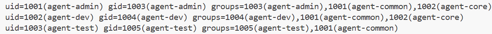

### 2-2. 디렉토리와 권한

```bash
sudo apt install -y acl
A=/home/agent-admin/agent-app
sudo setfacl -m g:agent-common:x /home/agent-admin
sudo mkdir -p $A/upload_files $A/api_keys /var/log/agent-app
sudo chown agent-admin:agent-common $A $A/upload_files
sudo chmod 750 $A
sudo chmod 2770 $A/upload_files
sudo setfacl -d -m g:agent-common:rwx $A/upload_files
sudo chown agent-admin:agent-core $A/api_keys /var/log/agent-app
sudo chmod 2770 $A/api_keys /var/log/agent-app
sudo ls -ld /home/agent-admin $A $A/upload_files $A/api_keys /var/log/agent-app
sudo getfacl /home/agent-admin $A/upload_files
```

| 경로 | 소유자:그룹 | 권한 | 의미 |
|---|---|---|---|
| `/home/agent-admin/agent-app` | agent-admin:agent-common | 750 | 세 계정 모두 들어와 목록을 볼 수 있다 |
| `…/upload_files` | agent-admin:agent-common | 2770 + 기본 ACL | agent-common 읽기·쓰기 |
| `…/api_keys` | agent-admin:agent-core | 2770 | agent-core만 읽기·쓰기 |
| `/var/log/agent-app` | agent-admin:agent-core | 2770 | agent-core만 읽기·쓰기 |

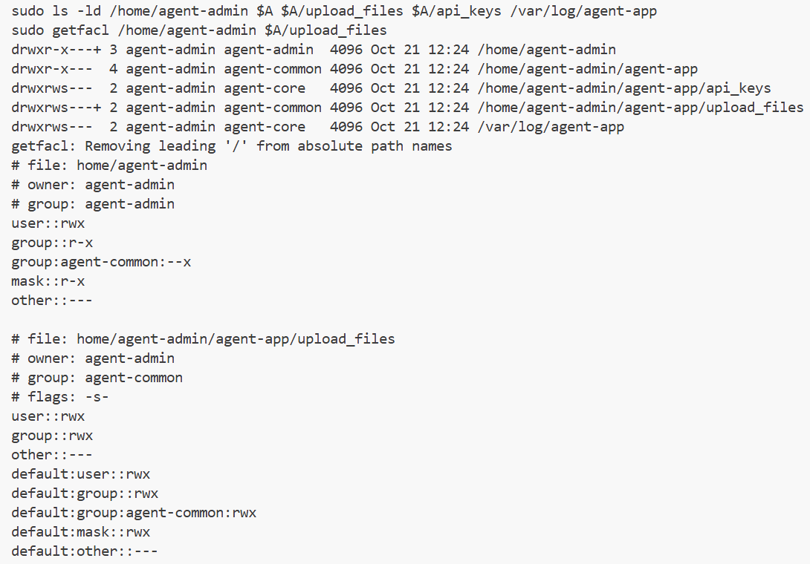

### 2-3. 접근 확인

agent-test는 `api_keys`·로그 폴더에서 거부되고 `upload_files`에는 쓸 수 있다. agent-dev는 `api_keys`를 읽고 `upload_files`에 쓸 수 있다.

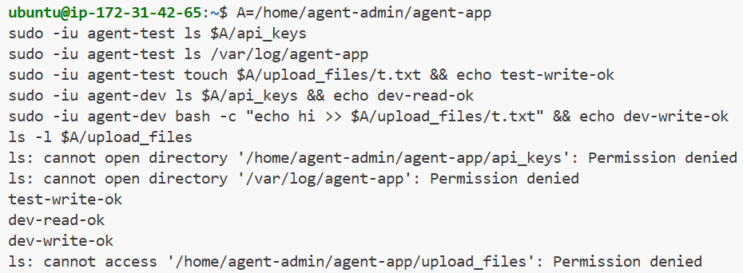

### 2-4. 설계 선택 (왜)

- **앱 경로를 예시대로 `/home/agent-admin/agent-app`**: 평가자가 보는 값과 같다. 대신 `adduser`가 만든 홈 폴더(750)는 다른 계정이 지나가지 못하므로 `setfacl -m g:agent-common:x`로 통과(`x`)만 열었다. `chmod o+x`는 계정 밖 모두에게 여는 것이라 그룹 ACL로 범위를 좁혔다.
- **`api_keys`·로그 폴더는 agent-core 전용(770)**: others 권한을 0으로 두면 agent-test(agent-core 아님)가 열 수 없다. 키 파일이 있는 곳이라 최소 권한으로 잡았다.
- **디렉토리에 setgid(`2`)**: 새 파일이 만든 사람의 개인 그룹이 아니라 폴더의 그룹(agent-core / agent-common)을 물려받는다. 이게 없으면 agent-admin이 만든 키·로그 파일을 agent-dev가 못 읽는다.
- **`upload_files`에 기본 ACL(`setfacl -d`)**: 새로 생기는 파일에도 agent-common 쓰기 권한이 유지된다. 일반 권한만 쓰면 만든 사람의 umask에 따라 그룹 쓰기가 빠질 수 있다.

## 3. 환경 변수·키 파일·앱 실행

### 3-1. 앱 파일 배치

과제 첨부 앱 중 서버 구조(`uname -m` = `x86_64`)에 맞는 `agent-app-linux-x86`을 `scp -P 20022`로 EC2에 보내 `$AGENT_HOME`에 두고 agent-admin만 실행하게 했다.

```bash
A=/home/agent-admin/agent-app
sudo mv ~/agent-app-linux-x86 $A/
sudo chown agent-admin:agent-admin $A/agent-app-linux-x86
sudo chmod 750 $A/agent-app-linux-x86
```

### 3-2. 환경 변수와 키 파일

`agent-admin`(`sudo -iu agent-admin`)의 `~/.bashrc` 끝에 변수 5개를 `export`로 추가하고, 키 파일을 만들었다.

```bash
cat >> ~/.bashrc <<'EOF'
export AGENT_HOME=/home/agent-admin/agent-app
export AGENT_PORT=15034
export AGENT_UPLOAD_DIR=$AGENT_HOME/upload_files
export AGENT_KEY_PATH=$AGENT_HOME/api_keys
export AGENT_LOG_DIR=/var/log/agent-app
EOF
source ~/.bashrc
echo agent_api_key_test > $AGENT_KEY_PATH/t_secret.key
cp -p $AGENT_KEY_PATH/t_secret.key $AGENT_KEY_PATH/secret.key
chmod 640 $AGENT_KEY_PATH/t_secret.key $AGENT_KEY_PATH/secret.key
```

키 파일 내용 `agent_api_key_test`는 명세가 정한 테스트 값이다(실제 키 아님).

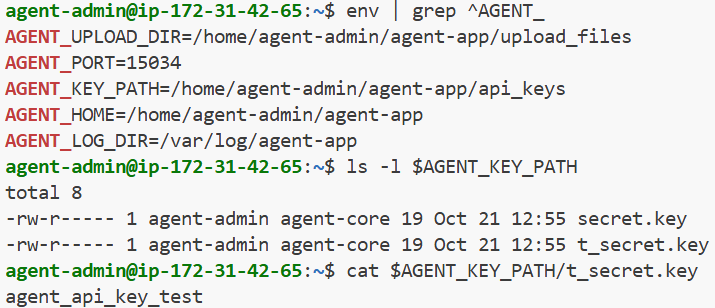

### 3-3. 앱 실행: Boot Sequence와 포트

일반 계정(agent-admin)으로 백그라운드 실행했다. root로는 실행하지 않았다.

```bash
cd $AGENT_HOME
PYTHONUNBUFFERED=1 nohup ./agent-app-linux-x86 > ~/agent-app.out 2>&1 &
cat ~/agent-app.out
ss -ltnp | grep 15034
ps -o pid,ppid,cmd -p "$(pgrep -d, -f agent-app-linux)"
```

Boot Sequence 5단계가 모두 `[OK]`이고 마지막에 `Agent READY`가 출력됐다.

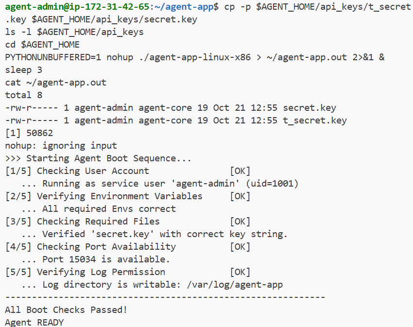

앱이 `0.0.0.0:15034`에서 LISTEN 중이다(PID 50864). 같은 이름의 프로세스가 둘 보이는데, 50862가 부모, 50864가 자식이고 포트를 연 쪽은 자식이다.

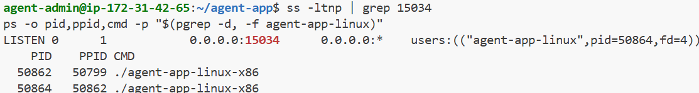

### 3-4. 설계 선택 (왜)

- **명세와 제공 앱이 어긋난 곳을 앱에 맞췄다**: 명세는 `AGENT_KEY_PATH`를 `…/api_keys/t_secret.key`(파일)로 적었지만, 앱은 폴더(`…/api_keys`)를 기대해 `[2/5]`에서 `Key Path Mismatch`로 실패했다. 또 앱은 그 폴더 안의 `secret.key`를 찾아 `[3/5]`에서 `Missing File`로 실패했다. 변수를 폴더 경로로 바꾸고, 명세 이름의 `t_secret.key`는 두고 같은 내용의 `secret.key`를 복사해 둘 다 만족시켰다.
- **환경 변수는 `agent-admin`의 `~/.bashrc`에**: 앱을 터미널에서 켜므로 거기서 읽힌다. cron은 이 파일을 읽지 않아서 `monitor.sh`는 안쪽 기본값으로 따로 처리한다.
- **`nohup … &`로 백그라운드 실행**: 터미널을 닫아도 앱이 유지되어 cron 점검 동안 계속 돈다. `PYTHONUNBUFFERED=1`은 출력이 파일에 바로 쓰이게 한다.
- **프로세스 찾기**: PyInstaller 앱이라 같은 이름 프로세스가 둘(부모·자식) 뜬다. `monitor.sh`는 `pgrep -fn`으로 가장 늦게 뜬 쪽(자식)을 고른다(§4-4).

## 4. monitor.sh 점검 스크립트

로그 기록·회전은 §5에서 다루고, 여기서는 Health Check·방화벽 경고·자원 수집·임계값 경고와 파일 권한을 다룬다. 스크립트는 Bash로만 작성했다.

### 4-1. 위치와 권한

`bin/monitor.sh`를 `scp -P 20022`로 EC2의 `/tmp`에 올린 뒤, `install`로 `$AGENT_HOME/bin/`에 소유자·권한을 지정해 배치했다. `bin` 폴더는 `agent-admin:agent-core` 750이다.

```bash
sudo install -o agent-dev -g agent-core -m 750 /tmp/monitor.sh /home/agent-admin/agent-app/bin/monitor.sh
sudo ls -l $A/bin/monitor.sh
```

`-rwxr-x--- agent-dev agent-core`로 소유자 agent-dev, 그룹 agent-core, 750이다. cron 실행 계정 agent-admin은 agent-core 소속이라 실행할 수 있고, agent-core가 아닌 agent-test는 `Permission denied`로 막힌다.

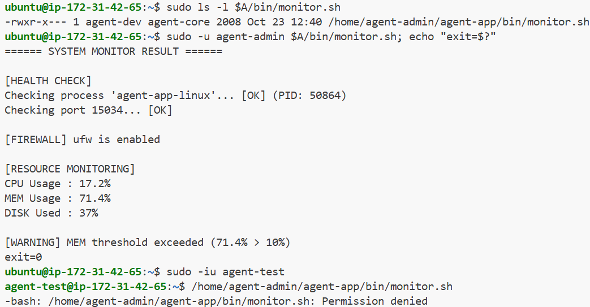

### 4-2. Health Check (실패 시 exit 1)

프로세스와 포트를 차례로 확인하고, 하나라도 비정상이면 `exit 1`로 종료한다.

```bash
PID=$(pgrep -fn "$APP")           # APP=agent-app-linux
[ -z "$PID" ] && { echo "... [ERROR] not running"; exit 1; }
ss -ltn "sport = :$PORT" | grep -q LISTEN || { echo "... [ERROR] not listening"; exit 1; }
```

앱이 켜져 있으면 `[OK] (PID: …)`와 `Checking port 15034... [OK]`가 나오고 종료 코드는 0이다. 앱을 `Ctrl+C`(`kill -INT`)로 끈 뒤 실행하면 `not running`이 출력되고 `exit=1`이다.

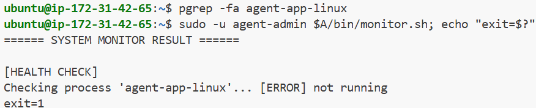

### 4-3. 방화벽 경고·자원 수집·임계값 경고

UFW가 꺼져 있으면 `[WARNING]`만 출력하고 계속 진행한다. 자원은 CPU(`/proc/stat`을 1초 간격으로 두 번 읽음), MEM(`free`의 total과 available), DISK(`df /`의 Used %)를 모으고, CPU 20%·MEM 10%·DISK 80%를 넘으면 `[WARNING]`만 출력한다. 경고가 떠도 종료 코드는 0이다.

```bash
grep -q '^ENABLED=yes' /etc/ufw/ufw.conf || echo "[WARNING] Firewall (ufw) is not enabled"
over "$MEM" 10 && echo "[WARNING] MEM threshold exceeded (${MEM}% > 10%)"
```

`ufw disable`로 방화벽을 끈 상태에서 실행하면 `[WARNING] Firewall (ufw) is not enabled`가 출력되고 `exit=0`이다. 확인 뒤 `sudo ufw --force enable`로 다시 켜서 20022·15034만 허용된 상태로 되돌렸다.

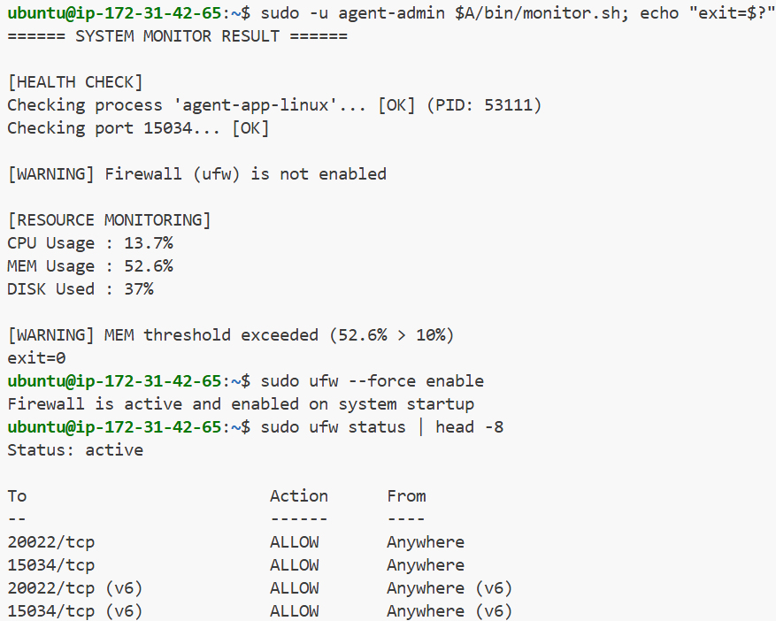

MEM은 이 서버에서 50~70%로 측정되어 임계값 10%를 계속 넘기므로 정상 실행에도 MEM 경고가 뜬다. 명세 임계값을 그대로 적용한 결과다.

### 4-4. 설계 선택 (왜)

- **프로세스 찾기는 `pgrep -fn`**: PyInstaller 앱은 같은 이름의 프로세스가 둘(부모·자식) 뜬다. `-n`으로 가장 늦게 뜬 자식, 즉 실제 포트를 연 쪽의 PID를 쓴다.
- **방화벽은 `/etc/ufw/ufw.conf`의 `ENABLED=yes`로 판단**: `ufw status`는 sudo가 필요한데 cron(agent-admin)에는 sudo가 없다. 설정 파일 값이라 실제 적용 상태와 어긋날 수 있지만 sudo 없이 읽을 수 있다.
- **임계값 비교는 `awk`**: Bash의 `[ ]`는 정수만 비교해서 `20.9` 같은 소수를 못 다룬다.
- **환경 변수에 기본값**: cron은 `~/.bashrc`를 읽지 않으므로 `PORT="${AGENT_PORT:-15034}"`처럼 스크립트 안에 기본값을 둔다. `sudo -u agent-admin`으로 돌려 cron과 같은 빈 환경에서 확인했다.
- **끝에 `exit 0`을 명시**: 마지막 `&&` 줄의 조건이 거짓이면 종료 코드가 1이 된다. 경고는 종료 사유가 아니므로 정상 종료를 명시했다.

## 5. 로그 기록·용량 관리

### 5-1. monitor.log 누적 기록

`monitor.sh`가 점검을 마칠 때마다 `/var/log/agent-app/monitor.log`에 한 줄을 `>>`로 이어 붙인다. 포맷은 `[YYYY-MM-DD HH:MM:SS] PID:<앱 PID> CPU:..% MEM:..% DISK_USED:..%`이고, CPU·MEM은 시스템 전체 사용률이다. 새로 추가한 코드는 `log()`·`rotate_log()` 함수와 호출 세 곳이다.

```bash
# 설치(로컬에서 scp로 /tmp에 올린 뒤)
sudo install -o agent-dev -g agent-core -m 750 /tmp/monitor.sh /home/agent-admin/agent-app/bin/monitor.sh

# 정상 실행 후 로그 확인
sudo -u agent-admin /home/agent-admin/agent-app/bin/monitor.sh
sudo tail -n 3 /var/log/agent-app/monitor.log
sudo ls -l /var/log/agent-app/monitor.log
```

실행 끝에 `[INFO] Log appended: /var/log/agent-app/monitor.log`가 출력되고, 로그에 `PID:53111 CPU:14.1% MEM:70.5% DISK_USED:37%` 줄이 생겼다. 파일은 `agent-admin:agent-core`, 권한 `rw-rw----`(660)이다.

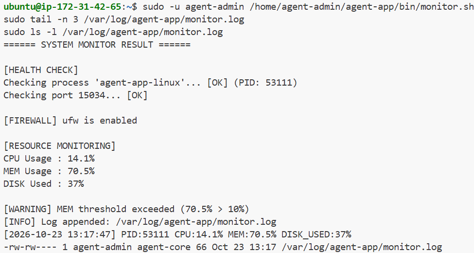

Health Check가 실패하면 종료(`exit 1`)하기 전에 실패 사유를 한 줄 남긴다. 앱은 켜 둔 채 `AGENT_PORT=1`로 포트 검사를 일부러 실패시켜 확인했다.

```bash
sudo -u agent-admin env AGENT_PORT=1 /home/agent-admin/agent-app/bin/monitor.sh; echo "exit=$?"
sudo tail -n 2 /var/log/agent-app/monitor.log
```

`exit=1`이 나오고 로그에 `[2026-10-23 13:18:50] HEALTH_CHECK_FAILED port`가 남았다.

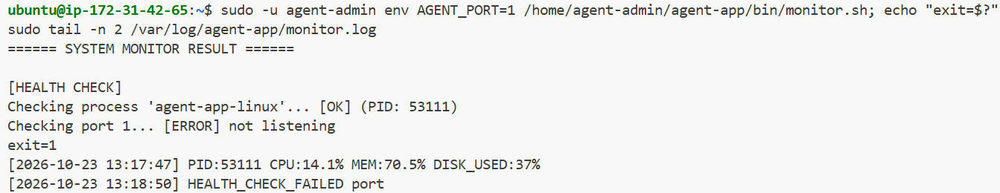

### 5-2. 10MB / 10개 회전

`monitor.log`가 10MB(10485760바이트) 이상이면 쓰기 직전에 회전한다. 가장 오래된 `.9`를 지우고 `.8→.9 … .1→.2`로 밀고 `monitor.log→monitor.log.1`로 옮긴다. 그래서 파일은 `monitor.log`와 `.1`~`.9`까지 최대 10개다.

실제 로그를 10MB로 채우는 대신 `MONITOR_LOG`로 경로를 `/tmp/rot_test.log`로 바꾸고, `truncate -s 10M`으로 10MB 파일을 만든 뒤 12번 실행했다(10개 제한을 넘기는 횟수).

```bash
sudo -u agent-admin bash -c 'export MONITOR_LOG=/tmp/rot_test.log; for i in $(seq 12); do truncate -s 10M "$MONITOR_LOG"; /home/agent-admin/agent-app/bin/monitor.sh >/dev/null; done'
ls -l /tmp/rot_test.log*
sudo rm -f /tmp/rot_test.log*
```

결과는 `rot_test.log`(66바이트)와 `.1`~`.9`(각 10485760바이트) 10개이고 `.10`은 없다. 확인 뒤 테스트 파일은 지웠다.

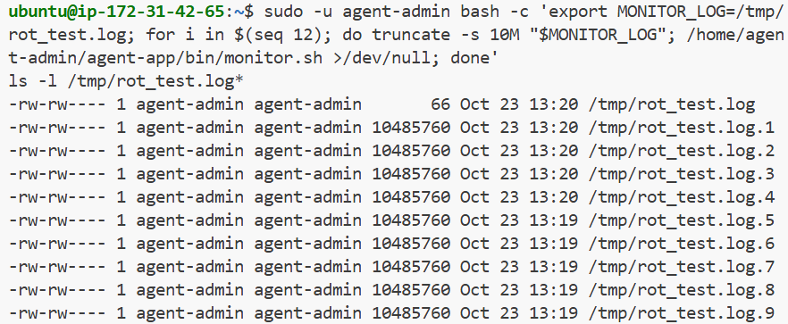

### 5-3. 설계 선택 (왜)

- **logrotate 대신 스크립트 안에서 회전**: 명세가 방법을 자유로 두었다. 매분 실행이 곧 점검이라 10MB를 넘는 즉시 회전되고, 별도 설정 파일을 서버에 따로 두지 않아도 된다. 대신 코드 10여 줄이 늘었다.
- **"최대 10개"는 현재 파일을 포함한 10개로 읽었다**: 명세에 풀이가 없어 `monitor.log` + `.1`~`.9`로 정했다.
- **쓰기 직전에 회전을 검사하는 `log()` 하나로 통일**: 정상 종료와 Health Check 실패 종료 어디서 불러도 같은 방식으로 회전된다.
- **실패해도 한 줄을 남긴다**: 앱이 죽은 시각이 로그에 남아야 장애 시점을 추적할 수 있다. 통계를 낼 때는 `CPU:`가 있는 줄만 읽으면 된다.
- **`umask 007`**: 로그를 처음 만드는 계정이 agent-admin(cron)이든 agent-dev(수동 실행)든 같은 그룹(agent-core)이 이어 쓸 수 있게 660으로 만든다.
- **`MONITOR_LOG` 환경 변수로 경로 덮어쓰기**: 회전 테스트가 실제 `/var/log/agent-app/monitor.log`를 건드리지 않게 하려는 용도다. cron에는 이 변수가 없어 기본 경로를 쓴다.

## 6. cron 매분 실행

### 6-1. agent-admin crontab 등록

`agent-admin`의 crontab에 `monitor.sh`를 매분 실행하도록 등록했다. 로그인 계정 `ubuntu`에서 `sudo -u agent-admin`으로 `crontab -`에 한 줄을 넘겼다.

```bash
sudo -u agent-admin crontab - <<'EOF'
# 전체 경로 필수(cron PATH가 빈약). 출력은 버린다: 기록은 monitor.sh가 monitor.log에 직접 남긴다
* * * * * /home/agent-admin/agent-app/bin/monitor.sh >/dev/null 2>&1
EOF
sudo -u agent-admin crontab -l
```

`crontab -l`에 `* * * * * /home/agent-admin/agent-app/bin/monitor.sh >/dev/null 2>&1`가 나온다. 앞의 다섯 칸은 분·시·일·월·요일이고 전부 `*`라 매분 실행이다.

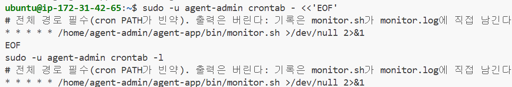

### 6-2. 자동 실행 확인 (1분 후 로그 증가)

등록 뒤 사람이 `monitor.sh`를 실행하지 않고 기다린 다음 로그를 봤다.

```bash
date
sudo tail -n 5 /var/log/agent-app/monitor.log
sudo wc -l /var/log/agent-app/monitor.log
```

`date`는 `13:33:34`이고, 로그 4줄 중 앞 두 줄(`13:17:47`, `13:18:50`)은 §5에서 직접 실행한 기록이다. 그 뒤에 `13:32:02`와 `13:33:02` 줄이 정확히 1분 간격으로 추가됐다. 초가 `:02`로 같은 것은 cron이 매분 0초에 시작하고, `monitor.sh`가 CPU 측정에 1초 쉰 뒤 기록하기 때문이다.

```
[2026-10-23 13:32:02] PID:53111 CPU:17.4% MEM:70.1% DISK_USED:37%
[2026-10-23 13:33:02] PID:53111 CPU:21.0% MEM:70.2% DISK_USED:37%
```

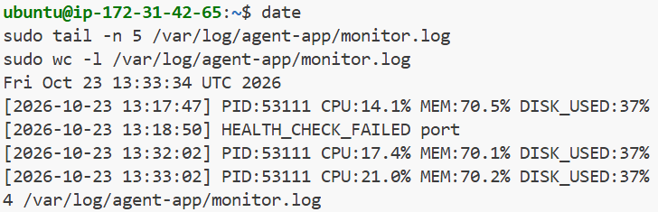

### 6-3. 설계 선택 (왜)

- **등록 계정은 `agent-admin`**: 명세가 cron 실행자로 지정했다. `monitor.sh`(`agent-dev:agent-core`, 750)를 실행하려면 `agent-core` 소속이어야 하는데 `agent-admin`이 그렇다.
- **스크립트 전체 경로 사용**: cron은 `PATH`가 `/usr/bin:/bin` 정도로 비어 있고 작업 폴더도 홈이라, 상대 경로나 `monitor.sh`만 쓰면 못 찾는다.
- **출력은 `/dev/null`로 버림**: 안 버리면 cron이 출력을 메일로 보내려 한다. 점검 결과는 `monitor.sh`가 `monitor.log`에 직접 남기므로 따로 `>>`를 붙이지 않았다. 대신 cron 실행 자체가 실패하면 화면에 흔적이 없고 `monitor.log`에 줄이 안 느는 것으로만 드러난다.
- **crontab에 환경 변수를 넣지 않음**: `monitor.sh` 안에 `AGENT_PORT`·`MONITOR_LOG` 기본값이 있어 cron의 빈 환경에서도 같은 값으로 돈다(§4-4).

## 7. (보너스 1) report.sh 요약 리포트

### 7-1. 설치

`monitor.sh`와 같은 방식으로 올렸다. 로컬 Windows PowerShell에서 `scp`로 `/tmp`에 올린 뒤, 서버의 `ubuntu` 계정에서 `install`로 `$AGENT_HOME/bin/`에 소유자·그룹·권한을 정해 복사한다.

```bash
# 로컬 PowerShell
scp -P 20022 -i "<키 경로>.pem" bin/report.sh ubuntu@<EC2 IP>:/tmp/report.sh

# 서버(ubuntu)
sudo install -o agent-dev -g agent-core -m 750 /tmp/report.sh /home/agent-admin/agent-app/bin/report.sh
```

### 7-2. 실행 결과

`agent-admin`으로 실행하면 `monitor.log`의 정상 기록 줄을 읽어 CPU·MEM·DISK의 평균·최대·최소와 샘플 수를 출력한다.

```bash
/home/agent-admin/agent-app/bin/report.sh
```

| 항목 | 평균 | 최대 | 최소 |
|---|---|---|---|
| CPU | 24.0% | 35.1% (13:42:03) | 0.5% (13:56:03) |
| Memory | 69.3% | 70.5% (13:17:47) | 68.9% (14:00:02) |
| Disk | 37.0% | 37.0% | 37.0% |

샘플 수는 `Data Points: 38 samples`다. 최대·최소 옆 시각은 그 값이 찍힌 로그 줄의 시각이다.

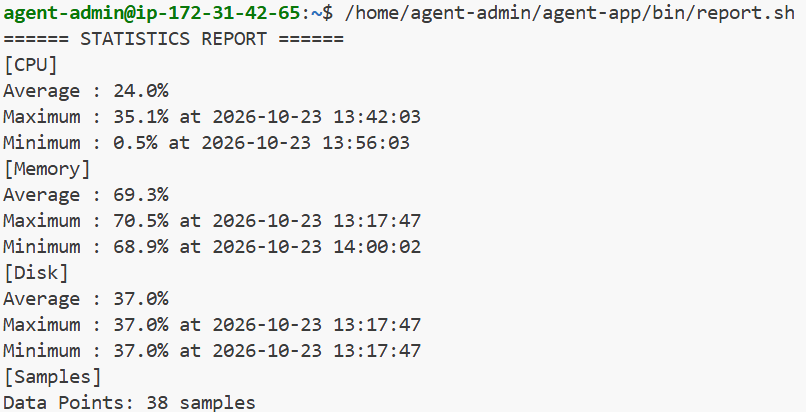

### 7-3. 설계 선택 (왜)

- **정상 기록 줄만 집계**: Health Check가 실패한 줄(`HEALTH_CHECK_FAILED ...`)에는 수치가 없다. 4번째 칸이 `CPU:`로 시작하는 줄만 읽어 평균이 깨지지 않게 했다.
- **계산은 `awk`**: `35.1` 같은 소수를 그대로 더하고 비교한다. Bash `[ ]`는 정수만 다룬다(§4-4와 같은 이유).
- **로그 경로는 `MONITOR_LOG`로 바꿀 수 있음**: 기본값은 `/var/log/agent-app/monitor.log`로 `monitor.sh`와 같다.
- **로그가 없거나 샘플이 0개면 exit 1**: 읽을 수 없으면 `[ERROR]`, 줄은 있으나 정상 기록이 없으면 `[WARNING]`을 내고 끝난다.
- **한계**: 현재 `monitor.log`만 읽고 회전된 `monitor.log.1~.9`는 읽지 않는다. 시작/종료 시간을 입력받아 구간만 분석하는 선택 기능은 넣지 않았다(원문이 "선택").

## 8. (보너스 2) 시간 기반 로그 보존 정책

`bin/log_retention.sh`가 `/var/log/agent-app`의 7일 이상 지난 로그를 압축해 `/var/log/monitor/agent-app/archive/`로 옮기고, 아카이브의 30일 이상 지난 `.gz`를 지운다. cron에는 등록하지 않았고 필요할 때 `agent-admin`이 직접 실행한다.

### 8-1. 설치와 아카이브 폴더

`/var/log`는 root 소유라 `agent-admin`이 아카이브 폴더를 만들 수 없어서, 폴더 생성과 소유자 지정은 서버의 `ubuntu` 계정이 `sudo`로 한다. 스크립트는 `report.sh`와 같은 방식(`scp` 후 `install`)으로 올렸다.

```bash
# 로컬 PowerShell
scp -P 20022 -i "<키 경로>.pem" bin/log_retention.sh ubuntu@<EC2 IP>:/tmp/log_retention.sh

# 서버(ubuntu)
sudo install -o agent-dev -g agent-core -m 750 /tmp/log_retention.sh /home/agent-admin/agent-app/bin/log_retention.sh
sudo mkdir -p /var/log/monitor/agent-app/archive
sudo chown -R agent-admin:agent-core /var/log/monitor
sudo chmod -R 2770 /var/log/monitor
```

`log_retention.sh`는 `agent-dev:agent-core`, 750이다.

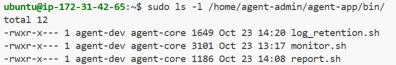

### 8-2. 동작 확인

7일·30일을 기다릴 수 없어 `touch -d`로 수정 시각을 거짓으로 만든 테스트 파일을 썼다. `agent-admin`으로 8일 전 `test_old.log`와 40일 전 `test_ancient.gz`를 만들었다.

```bash
touch -d "8 days ago" /var/log/agent-app/test_old.log
echo dummy | gzip > /var/log/monitor/agent-app/archive/test_ancient.gz
touch -d "40 days ago" /var/log/monitor/agent-app/archive/test_ancient.gz
```

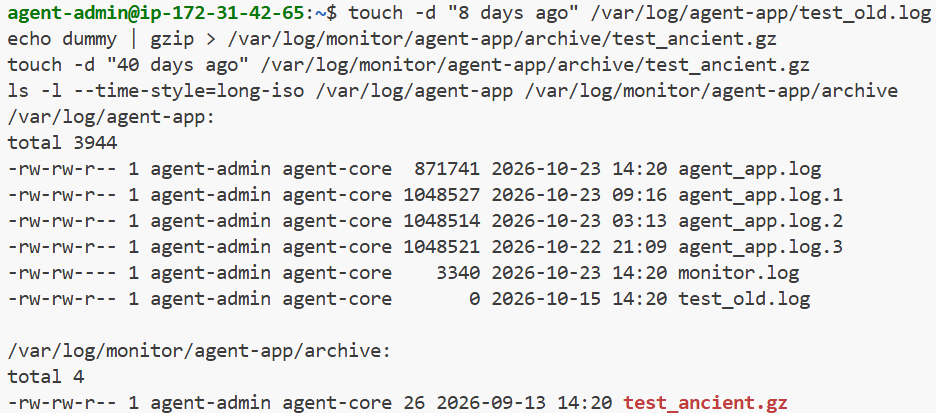

실행하면 `test_old.log`는 압축돼 아카이브로 옮겨지고, `test_ancient.gz`는 삭제된다. 같은 폴더의 `agent_app.log`·`monitor.log`는 최근 수정이라 그대로 남는다.

```bash
/home/agent-admin/agent-app/bin/log_retention.sh; echo "exit=$?"
```

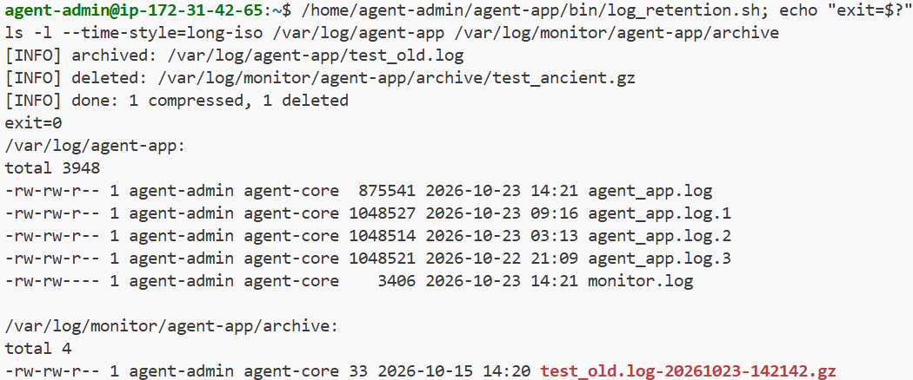

아카이브된 `test_old.log-20261023-142142.gz`의 수정 시각이 실행한 날이 아니라 원본의 `2026-10-15`로 남은 것이 보인다(gzip이 원본 시각을 물려준다).

### 8-3. 예외 처리

| 상황 | 출력 | 종료 코드 |
|---|---|---|
| 대상 파일 0개 | `[INFO] nothing to do (...)`, `0 compressed, 0 deleted` | 0 |
| 로그 폴더 없음 (`LOG_DIR=/var/log/nonexistent`) | `[ERROR] log dir not found` | 1 |
| 아카이브 폴더를 못 만들거나 쓸 수 없음 (`ARCHIVE_DIR=/root/x`, 권한 부족) | `[ERROR] archive dir missing or not writable` | 1 |
| 파일 하나의 압축·삭제 실패 | `[WARNING] failed to ...` 후 나머지 계속 | 0 |

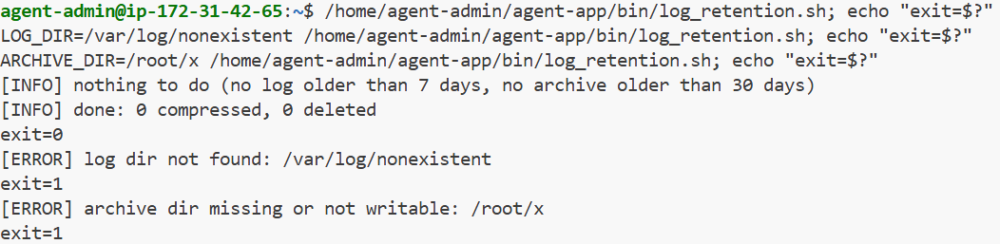

앞의 두 `[ERROR]`는 아무것도 건드리지 않고 끝난다. 마지막 줄(파일 하나 실패)은 일부러 실패를 만들어 보지 않아 캡처가 없다.

### 8-4. 설계 선택 (왜)

- **시간 기준은 `find -mmin`**: `-mtime`은 일 단위로 잘라 세서 "정확히 7일"이 애매하다. 7일=10080분, 30일=43200분으로 적었다.
- **대상은 `*.log`와 `*.log.[0-9]`**: 명세는 `*.log`만 적었지만, `monitor.sh`가 회전한 `monitor.log.1~.9`(그리고 앱의 `agent_app.log.1~.3`)는 이름이 `.log`로 끝나지 않아 오래돼도 영영 안 잡힌다. 그래서 회전 파일까지 넓혔다.
- **아카이브 이름에 시각을 붙임**: 같은 이름(`monitor.log.1`)이 다음 주에 또 아카이브되면 덮어써 지므로 `<원래이름>-<날짜-시각>.gz`로 저장한다.
- **30일은 원본 수정 시각 기준**: 압축·`mv`해도 수정 시각이 유지돼 "아카이브된 지 30일"이 아니라 "마지막 기록 후 30일"이 된다. 7일 압축 뒤 약 23일 더 보관한다.
- **아카이브 폴더가 없으면 `mkdir -p`부터 시도**: 만들 수 있으면 폴더 없음은 오류가 아니다. 못 만들거나 쓰기 권한이 없으면 그때 `[ERROR]`로 끝낸다.
- **`LOG_DIR`·`ARCHIVE_DIR`로 경로를 바꿀 수 있음**: `monitor.sh`의 `MONITOR_LOG`와 같은 방식이다. 기본값은 명세 경로다.
- **한계**: cron 자동 실행은 넣지 않았다. 활성 `monitor.log`가 7일 넘게 안 바뀐 경우(앱·cron이 7일 멈춘 경우)에는 그 파일도 압축된다.
